# DER de Tenis Ahora

Una tabla completa por rol (`socio`, `empleado`, `administrador`, `profesor` y `entrenador`), sin tabla `persona`. El diagrama está en tercera forma normal. GitHub lo dibuja solo; para editarlo se puede pegar el código en draw.io (Organizar, Insertar, Avanzado, Mermaid) o en mermaid.live.

## Desvíos del módulo Clases (BACK 11) respecto al diagrama

- `actividad_dia`: en el código tiene `id` propio (`@GeneratedValue`) más una `UNIQUE (actividad_id, dia_semana)`, en vez de la clave compuesta del diagrama. Es como está armada toda tabla del proyecto con relación N a N o de detalle, y evita `@IdClass`/`@EmbeddedId`, de los que no hay ningún precedente en el repo.
- `cupo_por_categoria` **no está implementada**: se decidió que el cupo se fija por clase (CU70), no por categoría. La columna `categoria` de `actividad` queda como un texto libre, sin FK.
- `nivel` vive en la misma tabla `actividad` (no en una tabla `clase` separada): la herencia es de tabla única (`SINGLE_TABLE`) con el discriminador `tipo_actividad`, así que todas las columnas de `Clase` y `Entrenamiento` están en `actividad` y quedan `NULL` para el otro subtipo.

## Desvíos del módulo Entrenamientos y asistencia (BACK 12) respecto al diagrama

- `asistencia` tiene además una `UNIQUE (actividad_id, socio_id, fecha)`: una asistencia es una por alumno, por actividad y por fecha, así que volver a registrarla corrige el `presente` en vez de insertar otra fila. El diagrama Mermaid no expresa UK compuestas por campo, por eso no aparece en el bloque de la entidad. También se agregó el índice `(socio_id, fecha)`, por donde consulta el futuro reporte de asistencias (CU68).
- `profesor_id` y `entrenador_id` de `actividad` ya estaban en el diagrama como nullable (`profesor |o--o{ actividad` y `entrenador |o--o{ actividad`): antes de BACK 12 el código los tenía mal, uno en `Clase` y otro en `Entrenamiento`, los dos `optional = false`. BACK 12 los sube a `Actividad` como nullable, que es justo lo que ya decía este DER; la regla de cuál es obligatorio según el tipo y la modalidad pasa al service (`ValidacionDeInstructorPorModalidad`), no al esquema.

```mermaid
erDiagram
    socio {
        bigint id PK
        varchar(80) nombre
        varchar(80) apellido
        varchar(8) dni UK
        date fecha_nacimiento
        varchar(150) calle
        varchar(6) numero_calle
        varchar(4) codigo_area
        varchar(8) numero_telefono
        varchar(120) email UK
        varchar(100) password_hash
        boolean activo
        varchar(30) motivo_deshabilitacion
        date fecha_alta
        varchar(300) foto_url
        varchar(30) genero
        text observaciones
        bigint rol_id FK
        boolean pendiente_asignacion
        integer intentos_fallidos
        timestamp bloqueado_hasta
        varchar(20) numero_socio UK
        varchar(50) codigo_barras
        numeric_5_2 peso
        numeric_5_2 altura
        bigint grupo_descuento_id FK
        numeric_10_2 saldo_a_favor
    }
    empleado {
        bigint id PK
        varchar(80) nombre
        varchar(80) apellido
        varchar(8) dni UK
        date fecha_nacimiento
        varchar(150) calle
        varchar(6) numero_calle
        varchar(4) codigo_area
        varchar(8) numero_telefono
        varchar(120) email UK
        varchar(100) password_hash
        boolean activo
        varchar(30) motivo_deshabilitacion
        date fecha_alta
        varchar(300) foto_url
        varchar(30) genero
        text observaciones
        bigint rol_id FK
        boolean pendiente_asignacion
        integer intentos_fallidos
        timestamp bloqueado_hasta
        date fecha_contratacion
    }
    administrador {
        bigint id PK
        varchar(80) nombre
        varchar(80) apellido
        varchar(8) dni UK
        date fecha_nacimiento
        varchar(150) calle
        varchar(6) numero_calle
        varchar(4) codigo_area
        varchar(8) numero_telefono
        varchar(120) email UK
        varchar(100) password_hash
        boolean activo
        varchar(30) motivo_deshabilitacion
        date fecha_alta
        varchar(300) foto_url
        varchar(30) genero
        text observaciones
        bigint rol_id FK
        boolean pendiente_asignacion
        integer intentos_fallidos
        timestamp bloqueado_hasta
        boolean es_administrador
    }
    profesor {
        bigint id PK
        varchar(80) nombre
        varchar(80) apellido
        varchar(8) dni UK
        date fecha_nacimiento
        varchar(150) calle
        varchar(6) numero_calle
        varchar(4) codigo_area
        varchar(8) numero_telefono
        varchar(120) email UK
        varchar(100) password_hash
        boolean activo
        varchar(30) motivo_deshabilitacion
        date fecha_alta
        varchar(300) foto_url
        varchar(30) genero
        text observaciones
        bigint rol_id FK
        boolean pendiente_asignacion
        integer intentos_fallidos
        timestamp bloqueado_hasta
        date fecha_contratacion
        bigint certificacion_id FK
        varchar(20) estado_validacion
        bigint validado_por_id FK
        date fecha_validacion
        numeric_10_2 valor_por_hora
        varchar(150) titulo_habilitante
        varchar(30) especialidad
        varchar(200) motivo_rechazo
    }
    entrenador {
        bigint id PK
        varchar(80) nombre
        varchar(80) apellido
        varchar(8) dni UK
        date fecha_nacimiento
        varchar(150) calle
        varchar(6) numero_calle
        varchar(4) codigo_area
        varchar(8) numero_telefono
        varchar(120) email UK
        varchar(100) password_hash
        boolean activo
        varchar(30) motivo_deshabilitacion
        date fecha_alta
        varchar(300) foto_url
        varchar(30) genero
        text observaciones
        bigint rol_id FK
        boolean pendiente_asignacion
        integer intentos_fallidos
        timestamp bloqueado_hasta
        date fecha_contratacion
        bigint certificacion_id FK
        varchar(20) estado_validacion
        bigint validado_por_id FK
        date fecha_validacion
        numeric_10_2 valor_por_hora
        varchar(150) certificacion_deportiva
        varchar(30) especialidad
        varchar(200) motivo_rechazo
    }
    certificacion {
        bigserial id PK
        varchar(50) numero_certificacion UK
        varchar(120) entidad_emisora
        date fecha_emision
        date fecha_vencimiento
        varchar(300) archivo_titulo_url
    }
    profesor_dia {
        bigint profesor_id PK, FK
        smallint dia_semana PK "1 a 7"
    }
    entrenador_dia {
        bigint entrenador_id PK, FK
        smallint dia_semana PK "1 a 7"
    }
    rol {
        bigserial id PK
        varchar(50) nombre UK
        varchar(200) descripcion
        boolean es_de_sistema
        bigint creado_por_id FK
        timestamp fecha_creacion
    }
    rol_permiso {
        bigserial id PK
        bigint rol_id FK
        varchar(40) modulo
        boolean ver
        boolean crear
        boolean editar
        boolean eliminar
    }
    permiso_especial {
        bigserial id PK
        bigint rol_id FK
        varchar(40) clave
        boolean otorgado
    }
    excepcion_permiso_usuario {
        bigserial id PK
        bigint persona_id "id de cualquiera de las 5 tablas de personas, sin FK"
        varchar(40) modulo
        varchar(10) accion
        boolean otorgado
    }
    cancha {
        bigserial id PK
        varchar(30) identificador
        varchar(20) tipo_superficie
        integer capacidad
        numeric_10_2 precio_por_hora
        varchar(20) estado
        boolean iluminacion_nocturna
        boolean techada
        boolean tribuna_publico
        boolean apta_torneos_oficiales
        text observaciones
        time hora_apertura
        time hora_cierre
        integer duracion_turno
    }
    disponibilidad {
        bigserial id PK
        bigint cancha_id FK
        date fecha
        time hora_inicio
        time hora_fin
        varchar(20) estado
        varchar(30) motivo_bloqueo
    }
    cupo_por_cancha {
        bigserial id PK
        bigint cancha_id FK, UK
        integer cupo_maximo
    }
    reserva {
        bigserial id PK
        varchar(20) codigo UK
        date fecha
        time hora_inicio
        time hora_fin
        varchar(20) estado
        bigint cancha_id FK
        integer cantidad_jugadores
        numeric_10_2 monto_total
        timestamp fecha_creacion
        text motivo_cancelacion
    }
    reserva_jugador {
        bigserial id PK
        bigint reserva_id FK
        varchar(100) nombre_invitado
        varchar(100) apellido_invitado
        varchar(30) documento_invitado
        bigint socio_id FK
        boolean es_titular
    }
    reserva_insumo {
        bigserial id PK
        bigint reserva_id FK
        bigint insumo_id FK
        integer cantidad_asignada
        boolean repuesto
    }
    categoria_insumo {
        bigserial id PK
        varchar(50) nombre UK
    }
    insumo {
        bigserial id PK
        varchar(80) nombre
        bigint categoria_id FK
        integer cantidad_total
        integer cantidad_disponible
        integer cantidad_minima
        integer unidades_por_reserva
        boolean reponer_al_finalizar
        boolean obligatorio_para_confirmar
        boolean notificar_stock_minimo
    }
    movimiento_stock {
        bigserial id PK
        bigint insumo_id FK
        varchar(20) tipo
        integer cantidad
        timestamp fecha
        bigint reserva_id FK
        varchar(200) motivo
    }
    cobro {
        bigserial id PK
        varchar(20) codigo UK
        varchar(15) estado
        varchar(20) concepto
        varchar(20) medio_pago
        integer cuotas
        timestamp fecha_expiracion_qr
        numeric_10_2 monto_base
        numeric_10_2 monto_final
        timestamp fecha
        bigint reserva_id FK
        bigint torneo_id FK
        bigint actividad_id FK
        bigint registrado_por_id FK
        varchar(60) numero_operacion
        varchar(60) id_pago_externo UK
    }
    recibo {
        bigserial id PK
        varchar(20) numero_recibo UK
        varchar(15) estado
        bigint cobro_id FK, UK
        numeric_10_2 monto
        varchar(60) concepto
        varchar(20) medio_pago
        varchar(60) numero_operacion
        text observaciones
        timestamp fecha_emision
    }
    nota_credito {
        bigserial id PK
        varchar(20) numero_nota_credito UK
        bigint recibo_original_id FK
        text motivo
        numeric_10_2 monto_ajustado
        timestamp fecha
        bigint emitida_por_id FK
    }
    descuento {
        bigserial id PK
        varchar(20) codigo UK
        varchar(80) nombre
        varchar(25) tipo_beneficiario
        text descripcion
        varchar(30) aplica_a
        numeric_5_2 porcentaje
        numeric_10_2 monto_fijo
        numeric_10_2 tope_maximo_por_operacion
        integer cantidad_minima_horas
        text condiciones
        date fecha_vigencia_desde
        date fecha_vigencia_hasta
        boolean acumulable_con_otros
        boolean aplicacion_automatica
        boolean requiere_validacion_manual
        boolean activo
        bigint configurado_por_id FK
    }
    descuento_dia {
        bigint descuento_id PK, FK
        smallint dia_semana PK "1 a 7"
    }
    cobro_descuento {
        bigserial id PK
        bigint cobro_id FK
        bigint descuento_id FK
        integer orden
        numeric_10_2 monto_descontado
    }
    actividad {
        bigserial id PK
        varchar(15) tipo_actividad
        varchar(20) codigo UK
        varchar(80) nombre
        date fecha_inicio
        date fecha_fin
        time hora_inicio
        time hora_fin
        bigint cancha_id FK
        integer cupo_maximo
        integer cupo_minimo
        varchar(15) modalidad
        varchar(15) estado
        numeric_10_2 valor_mensual
        bigint profesor_id FK
        varchar(30) categoria FK
        bigint entrenador_id FK
        varchar(15) nivel
    }
    actividad_dia {
        bigint actividad_id PK, FK
        smallint dia_semana PK "1 a 7"
    }
    cupo_por_categoria {
        bigserial id PK
        varchar(30) categoria UK
        integer cupo_maximo
    }
    inscripcion_clase {
        bigserial id PK
        bigint socio_id FK
        bigint actividad_id FK
        date fecha_inscripcion
        boolean activa
    }
    asistencia {
        bigserial id PK
        bigint socio_id FK
        bigint actividad_id FK
        date fecha
        boolean presente
    }
    torneo {
        bigserial id PK
        varchar(20) codigo UK
        varchar(100) nombre
        varchar(15) categoria
        varchar(10) modalidad
        varchar(20) tipo_superficie
        varchar(30) formato
        integer cantidad_participantes
        date fecha_inicio
        date fecha_fin
        date fecha_cierre_inscripcion
        varchar(25) estado
        numeric_10_2 costo_inscripcion
        varchar(20) sistema_puntuacion
        boolean tie_break_en_todos_los_sets
        boolean validar_resultados_reglas_oficiales
        text reglamento_interno
    }
    inscripcion {
        bigserial id PK
        bigint socio_id FK
        bigint torneo_id FK
        bigint pareja_id FK
        date fecha_inscripcion
    }
    partido {
        bigserial id PK
        bigint torneo_id FK
        varchar(15) ronda
        bigint participante_a_id FK
        bigint participante_b_id FK
        bigint cancha_id FK
        date fecha
        time hora_inicio
        varchar(60) resultado
        interval duracion_partido
        text observaciones_arbitro
    }
    partido_set {
        bigserial id PK
        bigint partido_id FK
        smallint numero_set
        smallint juegos_participante_a
        smallint juegos_participante_b
    }
    configuracion_club {
        bigserial id PK
        varchar(100) nombre_club
        varchar(200) descripcion
        varchar(15) cuit
        varchar(150) direccion
    }

    rol ||--o{ socio : "rol_id"
    rol ||--o{ empleado : "rol_id"
    rol ||--o{ administrador : "rol_id"
    rol ||--o{ profesor : "rol_id"
    rol ||--o{ entrenador : "rol_id"
    rol ||--o{ rol_permiso : "rol_id"
    rol ||--o{ permiso_especial : "rol_id"
    empleado ||--o{ rol : "creado_por_id"
    empleado |o--o{ profesor : "validado_por_id"
    empleado |o--o{ entrenador : "validado_por_id"
    empleado ||--o{ cobro : "registrado_por_id"
    empleado ||--o{ descuento : "configurado_por_id"
    empleado ||--o{ nota_credito : "emitida_por_id"
    certificacion |o--o{ profesor : "certificacion_id"
    certificacion |o--o{ entrenador : "certificacion_id"
    profesor ||--o{ profesor_dia : "profesor_id"
    entrenador ||--o{ entrenador_dia : "entrenador_id"
    descuento |o--o{ socio : "grupo_descuento_id"
    descuento ||--o{ descuento_dia : "descuento_id"
    descuento ||--o{ cobro_descuento : "descuento_id"
    cobro ||--o{ cobro_descuento : "cobro_id"
    cobro ||--|| recibo : "cobro_id"
    recibo ||--o{ nota_credito : "recibo_original_id"
    cancha ||--o{ disponibilidad : "cancha_id"
    cancha ||--o| cupo_por_cancha : "cancha_id"
    cancha ||--o{ reserva : "cancha_id"
    cancha ||--o{ actividad : "cancha_id"
    cancha ||--o{ partido : "cancha_id"
    reserva ||--o{ reserva_jugador : "reserva_id"
    reserva ||--o{ reserva_insumo : "reserva_id"
    reserva |o--o{ movimiento_stock : "reserva_id"
    reserva ||--o{ cobro : "reserva_id"
    socio |o--o{ reserva_jugador : "socio_id"
    insumo ||--o{ reserva_insumo : "insumo_id"
    insumo ||--o{ movimiento_stock : "insumo_id"
    categoria_insumo ||--o{ insumo : "categoria_id"
    socio ||--o{ inscripcion_clase : "socio_id"
    socio ||--o{ asistencia : "socio_id"
    socio ||--o{ inscripcion : "socio_id"
    socio |o--o{ inscripcion : "pareja_id"
    profesor |o--o{ actividad : "profesor_id"
    entrenador |o--o{ actividad : "entrenador_id"
    cupo_por_categoria ||--o{ actividad : "categoria"
    actividad ||--o{ actividad_dia : "actividad_id"
    actividad ||--o{ inscripcion_clase : "actividad_id"
    actividad ||--o{ asistencia : "actividad_id"
    actividad |o--o{ cobro : "actividad_id"
    torneo ||--o{ inscripcion : "torneo_id"
    torneo ||--o{ partido : "torneo_id"
    torneo |o--o{ cobro : "torneo_id"
    inscripcion ||--o{ partido : "participante_a_id"
    inscripcion ||--o{ partido : "participante_b_id"
    partido ||--o{ partido_set : "partido_id"
```

